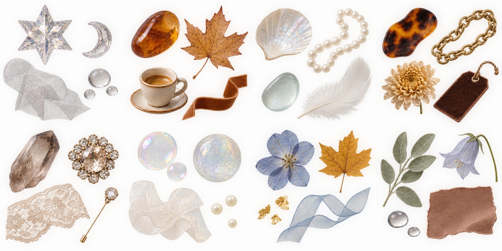

# Xiaohongshu Nail Editorial Remix

A reusable Codex skill for turning credited nail-art source images into asymmetric editorial scrapbook collages.

The core idea is **asset-specific design**: every manicure gets its own softened palette, material theme, line doodle, and decorative kit. The workflow preserves source identity and avoids repeating one fixed pink template, flower, bow, or butterfly across a batch.



## What it does

- preserves the original author, title, source link, and secondary-image credits;
- uses one dominant upper-left image and one supporting lower-right image;
- samples the current manicure instead of using a fixed default palette;
- forces unique theme names, palettes, and hero materials within a batch;
- keeps editorial analysis separate from source text;
- generates traceable batch manifests and validates final files;
- includes publication-risk and crediting safeguards.

## Install

Copy the folder into your Codex skills directory:

```text
~/.codex/skills/xiaohongshu-nail-editorial-remix/
```

Then invoke it with:

```text
Use $xiaohongshu-nail-editorial-remix to turn these credited nail images into a distinct editorial collage batch.
```

## Requirements

- Python 3.10+
- Pillow 10+
- local source images and reliable source/credit records

## Utilities

```bash
python scripts/palette_from_image.py path/to/nail.jpg
python scripts/validate_batch.py path/to/manifest.json --root path/to/project
```

## Repository safety

This repository intentionally excludes scraped Xiaohongshu posts, cookies, private tokens, and third-party example photographs. The included decorative atlas is synthetic. Local collage creation does not grant publication rights to source material.

## License

MIT for the skill instructions and scripts. Third-party source media used with the workflow remains subject to its own rights and permissions.

